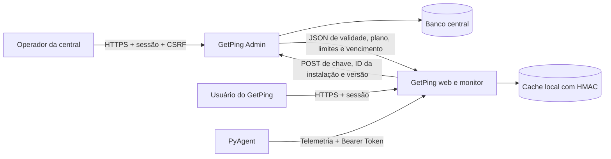

# GetPing + GetPing Admin — revisão de produção e comunicação

**Data:** 22/10/2026, referência America/Sao_Paulo.

**Parecer: ainda não recomendo liberar o conjunto para produção.** A comunicação HTTPS possui validação de certificado e hostname funcionando no worker real, mas HTTPS ainda é opcional nas configurações examinadas. Existem divergências comprovadas entre os contratos de licenciamento que permanecem mesmo com TLS corretamente configurado.

Os bloqueadores mais diretos são a interpretação de zero agentes, a negativa de instalação tratada como indisponibilidade e a publicação sem exigência efetiva de HTTPS. Também devem ser tratados o bloqueio dirigido de login do GetPing e os problemas de cache, horário e concorrência descritos abaixo.

## Escopo e versões

- **GetPing:** `../GetPing_eth/getping_v0.0.4`, versão declarada **1.0.7**, commit base `f64bf1a`, incluindo alterações locais em mapa CSS/JS e quatro imagens. O nome histórico da pasta não corresponde à versão declarada.
- **GetPing Admin:** este repositório, commit base `ec9d48d`, incluindo as correções e a migração 003 da revisão anterior.
- Foram examinados autenticação, autorização, configuração, transporte, licenciamento, cache, persistência, recebimento de agentes, coleta, proteções web, testes, dependências, CI e artefatos de instalação/deploy relevantes.
- O diretório histórico `version_deploy_getping/getping_v0.1` não foi considerado a versão atual a publicar. Não foi comprovado qual executável/release está instalado na VM/VPS.

Não alterei código funcional, banco, fingerprint, segredo ou configuração operacional de nenhum projeto. Os novos arquivos são este relatório e evidências no Admin. As alterações preexistentes do mapa foram preservadas.

## Validação realizada

| Verificação | Resultado atual |
|---|---|
| Suíte GetPing | **213 testes passaram**, 65,198 s |
| Suíte Admin | **122 testes passaram**, 27,944 s, com ResourceWarning tratado como erro |
| Ensaios cruzados | **15 cenários** registrados, usando código real dos dois lados e bancos temporários |
| Transporte real | **4 cenários** HTTP/TLS em loopback, com certificado temporário e subprocesso real do cliente |
| `pip check` nos dois venvs | Sem incompatibilidades |
| Ruff 0.17.1, lint | Código/scripts/testes examinados dos dois projetos passaram |
| Ruff, formatação | Dois arquivos pendentes em cada projeto; detalhes abaixo |
| Auditoria GetPing instalado | 19 distribuições examinadas; nenhuma vulnerabilidade conhecida apontada |
| Auditoria Admin instalado | Avisos somente no `pip==24.0`, ferramenta local; detalhes abaixo |
| Auditoria versões de produção do Admin | Lista expandida de requirements base + produção, sem vulnerabilidade conhecida apontada |
| Sintaxe shell do instalador/HTTPS/CLI GetPing | `bash -n` passou |
| JavaScript no navegador | Não reexecutado nesta revisão; Node indisponível |

O teste cruzado substitui somente o transporte por uma ponte para o Flask test client do Admin: JSON e estados produzidos pelo servidor real são processados pelo parser e persistência reais do GetPing. As autorizações no banco central são preparadas como fixtures; a UI administrativa não é automatizada nesses ensaios. A validação TLS separada usa sockets e worker reais, mas responde por um servidor temporário, não pela VPS.

Não foram feitos teste de carga representativo, ensaio prolongado na VM, restauração operacional, novo build Nuitka, auditoria de todo o histórico Git ou certificação de ausência de vulnerabilidades. Passar nos 335 testes existentes não cobre automaticamente os cenários novos.

**Evidências:** [diretório completo](evidencias_integracao_2026-10-22/), [contrato e cache](evidencias_integracao_2026-10-22/integracao.jsonl), [HTTP/TLS](evidencias_integracao_2026-10-22/transporte.jsonl), [script cruzado](evidencias_integracao_2026-10-22/auditar_integracao.py) e [script de transporte](evidencias_integracao_2026-10-22/auditar_transporte.py).

## Como os componentes se comunicam

O fingerprint é um identificador aleatório persistido em arquivo, não uma medição de hardware nem uma prova criptográfica de posse da instalação. O HMAC é gerado pelo próprio GetPing com segredo local; não é uma assinatura emitida pela central.

## Controles que estão funcionando

- A central exige autorização explícita para licenças novas. O fluxo `aguardando_vinculo → autorização → ativa` funcionou no ensaio cruzado.
- Suspensão e cancelamento emitidos pelo Admin bloquearam o estado local do GetPing.
- Requests valida certificados por padrão; o worker real rejeitou certificado não confiável e hostname incorreto. Com a CA temporária explicitamente confiada, a conexão funcionou. Isso está de acordo com a [documentação do Requests](https://requests.readthedocs.io/en/latest/user/advanced/#ssl-cert-verification).
- O worker não segue redirecionamentos, possui timeouts de conexão/leitura, teto de resposta de 64 KiB e deadline global imposto pelo processo pai. Não encontrei `verify=False` no caminho de licenciamento examinado.
- A API central valida payload, limita requisições, usa consultas parametrizadas e responde sem expor detalhes de banco.
- O Admin mantém CSRF, sessões revogáveis, permissões no servidor, migrações explícitas e diagnóstico de estrutura/dados. Os testes anteriores continuaram passando.
- O GetPing mantém CSRF, revalidação de sessão, troca obrigatória de senha inicial e papéis no servidor. Tokens novos de agentes são armazenados como hash e vinculados a identidade; o token necessário ao ensaio foi criado somente no banco temporário.
- Os exemplos de produção preveem WSGI em loopback e proxy TLS. A confiança nos cabeçalhos depende da topologia e da proteção do backend, conforme a [documentação do Flask](https://flask.palletsprojects.com/en/stable/deploying/proxy_fix/).

## Matriz dos principais achados

| ID | Gravidade contextual | Onde | Consequência / condição |
|---|---|---|---|
| A1 | Alta, se publicado em HTTP | Ambos/configuração | Credenciais de licença e identidade trafegam sem criptografia |
| A2 | Alta comercial | Contrato entre ambos | Central aceita/apresenta zero agentes; cliente interpreta zero como ilimitado |
| A3 | Alta comercial | GetPing | `instancia_invalida` vira falha de rede e preserva licença previamente ativa |
| A4 | Alta para a resistência local declarada, com escrita no banco | GetPing | Freshness e URL fora do HMAC; validação local não confere identidade atual |
| A5 | Alta de disponibilidade, se login acessível ao atacante | GetPing | Fontes diferentes conseguem bloquear o login correto da conta root |
| M1 | Média, se fuso do processo não for UTC | GetPing | Cache pode expirar em horário diferente da central |
| M2 | Média de concorrência | GetPing | Resposta antiga da chave A altera a licença B recém-ativada |
| M3 | Média de contrato | GetPing | Sucesso incompleto renova cache usando valores anteriores |
| M4 | Média / decisão de produto | GetPing | Coleta e telemetria não seguem a mesma regra de validade aplicada à interface |
| M5 | Média de integridade descritiva, com escrita no banco | GetPing | Serialização HMAC por delimitador permite ambiguidade entre cliente e plano |
| D1 | Decisão de confiança, impacto alto se o root da aplicação for adversário | GetPing | Root pode escolher outra autoridade de licenças; HMAC local não prova origem central |

As classificações condicionais não significam exploração remota anônima comprovada. Não foi identificada nesta revisão uma execução remota de código sem autenticação.

## Achados altos

### A1 — HTTPS não é obrigatório de ponta a ponta

**Locais:** GetPing `getping/config.py:110`, `getping/routes/licenca.py:29`, `getping/license_worker.py:12`; Admin `getping_admin/config.py` e `.env.example`.

O GetPing usa `http://localhost:5001` como fallback, aceita URL HTTP para a central e permite ao root informar uma URL HTTP. O arquivo de produção deixa a URL da central comentada. O Admin continua com `GETPING_REQUIRE_HTTPS=0` por padrão de transição. O ensaio real confirmou que o worker envia a chamada por HTTP e processa o retorno; não há proteção de transporte nessa situação.

**Impacto:** em comunicação HTTP entre máquinas por rede não confiável, quem intercepta o caminho pode obter chave/fingerprint ou alterar a resposta. Redirecionar/rejeitar no servidor não desfaz a exposição de um corpo já enviado por HTTP.

**Antes de publicar:** exigir origem HTTPS no cliente em modo de produção, com exceção de desenvolvimento explícita; configurar o domínio real, certificado e sua renovação; manter verificação TLS; ativar a exigência no Admin. Conferir também URLs já persistidas em `licenca_local.servidor_admin_url`, pois a sincronização usa esse valor e não apenas a variável de ambiente nova. Backend em loopback e firewall precisam ser verificados na implantação.

### A2 — Semântica de zero agentes divergente

**Locais:** Admin `routes/api.py:104` e formulário de licença; GetPing `getping/db/licenses.py:157` e `getping/licensing.py:147`.

O Admin permite armazenar/enviar `limite_agentes=0` e a interface apresenta um limite de zero. O GetPing documenta internamente zero como ilimitado e verifica o teto somente se o valor for maior que zero.

**Prova:** a central retornou licença válida com zero agentes. Uma chamada real a `/informacoes_agent`, com token válido criado no fixture, retornou **HTTP 200** e cadastrou um agente.

**Correção:** definir a regra comercial única e refletir nos dois projetos. Se zero significa nenhum agente, bloquear o primeiro cadastro no cliente e distinguir explicitamente ilimitado. Se zero significa ilimitado, a central deve declarar isso na UI/documentação e nos relatórios comerciais. Não é seguro deixar operadores e cliente interpretarem o mesmo valor de maneiras diferentes.

### A3 — Instalação rejeitada ainda usa o cache ativo

**Locais:** Admin `getping_admin/routes/api.py:78`; GetPing `getping/licensing.py:251–289`.

Após a transferência de uma licença, a central devolve `403`, `valido=false`, `status=instancia_invalida` para o fingerprint anterior. O cliente reconhece `aguardando_vinculo`, mas não reconhece `instancia_invalida` entre as negativas autoritativas. Converte a resposta em `conexao_falhou=true` e preserva a licença ativa no cache.

**Prova:** autorização para a instalação original, validação bem-sucedida e mudança do vínculo central para outra instalação. A central rejeitou a original; o GetPing continuou com `valida=true` e tratou a negativa como problema de rede.

**Correção:** reconhecer esse estado e bloquear a licença local imediatamente, sem tolerância offline. Publicar contrato versionado de estados e testar central/cliente juntos, incluindo transferência, liberação e tentativa da instalação antiga. A tolerância deve ser aplicada a indisponibilidade real, não a uma recusa explícita de autorização.

### A4 — Proteção do cache não cobre freshness, autoridade e identidade atual

**Locais:** GetPing `getping/db/licenses.py:16–56` e `getping/licensing.py:318–410`.

O HMAC cobre chave, cliente, plano, limites, status, expiração e o fingerprint gravado na própria linha. Não cobre `ultimo_checkin` ou `servidor_admin_url`. A validação compara o HMAC com o fingerprint da linha, sem compará-lo com o arquivo de identidade atual.

**Provas isoladas:**

1. Um check-in de nove dias atrás causou `offline_expirado`. Alterar somente `ultimo_checkin` para agora restabeleceu `valida=true`, mantendo a assinatura anterior válida e sem obter a chave HMAC.
2. Alterar somente a URL persistida não invalidou a assinatura.
3. Alterar o arquivo `.server_fingerprint` para outro identificador não invalidou o cache local anterior.

**Condição/limite:** esses ensaios pressupõem escrita no banco/arquivos locais ou restauração/cópia de estado. Não demonstram que um usuário web comum tenha essa permissão. Também não demonstram funcionamento após o vencimento assinado da licença. O problema é a resistência local anunciada ser menor que a implementada.

**Correção:** validar o cache antes de reaproveitá-lo, vincular a identidade atual, proteger autoridade e último sucesso/fim da tolerância, rejeitar timestamps ausentes/inválidos/futuros e definir serialização versionada. Para comprovar que a autorização veio da central, adotar documento assinado por ela, verificável com chave pública no cliente. Mesmo assim, controle total do SO permite adulterar o executável: documentar esse limite do modelo de ameaça.

### A5 — Bloqueio global dirigido de login no GetPing

**Locais:** GetPing `getping/security.py:20–90` e `getping/routes/auth.py:55`.

Existe orçamento compartilhado `conta:<username>` além das cotas por origem. A decisão de bloqueio acontece antes de conferir a senha correta. O problema equivalente já foi corrigido no Admin, mas permanece no GetPing.

**Prova:** quinze senhas incorretas para root, distribuídas por três IPs de fixture, com CSRF válido. Uma quarta origem apresentou a senha correta e recebeu **429**. Não houve acesso a contas reais. O bloqueio observado é de cinco minutos pela implementação atual, apesar de existir outra constante de dez minutos no arquivo.

**Correção:** redesenhar a defesa para não permitir que terceiros esgotem um bloqueio global barato; manter proteção por origem, controle na borda, detecção/alertas e avaliar MFA. Somente obter CSRF ou mover o contador após CSRF não elimina ataque distribuído com formulários válidos.

## Achados médios e decisões de produto

### M1 — Vencimento UTC interpretado como hora local

A central usa UTC e envia `expira_em_iso` com offset. O cliente persiste/avalia `expira_em` sem fuso e compara com `datetime.now()`. Não consome o campo ISO com offset.

No processo de teste em America/Sao_Paulo, uma licença vencida há uma hora em UTC continuou válida no cache, enquanto a central retornou `expirada`. Em processo UTC, esse desvio específico não ocorre. Uma sincronização que receba a negativa reconhecida corrige o estado, mas o cálculo local durante indisponibilidade continua errado.

**Correção:** contrato único UTC com datetimes conscientes de fuso, leitura prioritária do ISO e migração explícita dos campos locais. Testar UTC, São Paulo e relógio alterado. Além disso, `.days > MAX_DIAS_OFFLINE` arredonda a duração para baixo: com sete dias configurados, a janela pode chegar perto de oito dias. Comparar durações exatas e definir a política comercial.

### M2 — Resposta remota antiga altera licença nova

`sincronizar_licenca_com_servidor()` lê a chave, espera a rede e depois atualiza a licença local mais recente sem confirmar que ela ainda é a licença consultada. Uma resposta negativa de A pode suspender/cancelar B, ativada enquanto A aguardava. Uma resposta positiva antiga também pode sobrescrever uma ativação mais recente por meio de `DELETE` + `INSERT`.

**Prova:** o servidor respondeu cancelamento para A; antes da persistência, o fixture ativou B com resposta válida real da central. A continuação da sincronização de A deixou a chave B com status `cancelada`.

**Correção:** usar versão/revisão do estado e atualização condicional por chave/identidade/revisão capturadas antes da chamada; descartar resposta obsoleta. Não manter lock SQLite durante a chamada de rede. Testar sincronização de background concorrente com ativação/revalidação manual.

### M3 — Resposta positiva incompleta é aceita

O parser exige que `valido` seja booleano, mas não exige todos os campos de uma autorização positiva. `{"valido":true}` foi aceito; com licença anterior, o cliente reaproveitou plano, limites e vencimento e gravou um novo check-in/HMAC.

Não foi provado que a central atual produza esse retorno; o problema aparece com resposta defeituosa, proxy/autoridade incorreta ou alteração futura do contrato. Um cache sem validade continua sendo recusado pela verificação local, portanto não se afirma que esse JSON sozinho ative qualquer instalação nova.

**Correção:** schema de sucesso obrigatório, tipos/faixas alinhados ao Admin, expiração obrigatória e correspondência com a chave/instalação consultadas. Falha de contrato deve preservar o estado sem renovar freshness. Manter respostas negativas explicitamente documentadas e versionadas.

### M4 — Coleta não aplica a mesma regra de validade da interface

O middleware isenta `/informacoes_agent`; recebimento de host existente não verifica licença, e o cadastro verifica apenas o status bruto/quota. O coletor de sondas manuais não consulta o resultado completo de `verificar_status_licenca()` antes de continuar.

**Prova:** com cache `offline_expirado`, a telemetria de um agente já vinculado retornou **200**. A interface/API protegida pode bloquear ao mesmo tempo em que a coleta continua.

**Decisão necessária:** definir se a licença bloqueia apenas acesso/cadastro ou também a coleta. Continuidade de coleta pode ser intencional para evitar perda de histórico; nesse caso, documentar e limitar a política. Se o produto promete interrupção total, centralizar a autorização efetiva na coleta e no recebimento. Não classificar automaticamente toda continuidade como bypass sem essa decisão.

### M5 — Mensagem HMAC ambígua entre campos textuais

A mensagem usa concatenação de strings com `|`, sem escape ou estrutura canônica. Uma licença com cliente `Fixture|Profissional` e plano `Basico` continuou com assinatura válida após redistribuir os valores para cliente `Fixture` e plano `Profissional|Basico`.

A prova altera campos descritivos e exige escrita local. Não demonstra alteração de limites numéricos nem quebra do HMAC-SHA256. **Correção:** JSON canônico ou formato com comprimentos, versionado, com migração compatível e teste contra delimitação ambígua.

### D1 — Escolha da autoridade pelo root da aplicação

O fluxo de ativação permite que o root do GetPing escolha outro servidor HTTP/HTTPS. O HMAC posterior é local; qualquer resposta aceita do endpoint escolhido pode receber esse selo. HTTPS autentica o nome do endpoint escolhido, mas não estabelece que ele pertença ao fornecedor central autorizado.

Se root é um operador totalmente confiável, trata-se de uma capacidade administrativa documentável. Se é o administrador do cliente contra quem o licenciamento comercial precisa resistir, essa confiança não atende ao requisito. Definir uma origem autorizada protegida e/ou assinatura assimétrica da autorização central. Não foi demonstrada troca de autoridade por usuário anônimo ou comum.

## Dependências, qualidade e operação

### Resultado da auditoria de dependências

- GetPing: nenhum aviso conhecido entre as 19 distribuições instaladas consultadas. O certifi instalado já está na versão atualizada prevista na revisão anterior; não reabri como pendente o aviso histórico já corrigido.
- Admin: dependências declaradas de runtime/produção não tiveram avisos na consulta desta revisão. O ambiente local não contém Gunicorn instalado; sua versão declarada foi auditada separadamente, sem validar uma execução WSGI real.
- O `pip==24.0` do venv local do Admin gerou 12 registros de aviso, correspondentes a **seis IDs distintos** repetidos na resposta da base. Isso afeta a ferramenta de instalação, não comprova uma vulnerabilidade HTTP explorável no painel. Atualizar a ferramenta na preparação da release e repetir a auditoria.
- As consultas são um retrato da base de vulnerabilidades em 22/10/2026, não garantia de ausência de falhas. As ferramentas de auditoria foram instaladas somente em `/tmp`.

### SQLite e concorrência

Os runtimes locais usam SQLite **3.45.1**, e ambos usam WAL. Confirmar no pacote de sistema usado pelo Python da VPS a correção do [problema raro WAL-reset](https://www.sqlite.org/wal.html#walreset), descrito pelo mantenedor, incluindo eventual backport sem mudança da versão base. Não foi observado banco corrompido nesta revisão.

A mesma documentação explica que WAL continua permitindo um escritor por vez e exige armazenamento local compartilhado no mesmo host. A API do Admin escreve para cotas e check-ins; o GetPing também grava telemetria e histórico. É necessário medir contenção/latência em vez de aumentar workers sem evidência.

A cota padrão central de 120 validações por IP/minuto é compartilhada entre instalações atrás do mesmo NAT; o GetPing sincroniza a cada 60 segundos, além de validações acionadas por login/configuração. Medir picos, retries e retomada após indisponibilidade. Avaliar jitter/backoff e limites no proxy; 429 não deve renovar a tolerância offline.

### Qualidade e release

- Lint passou; formatação do Admin está pendente em `getping_admin/routes/clientes.py` e `tests/test_permissoes_assistente.py`. O CI do Admin exige esse check, portanto ele precisa ser ajustado antes da release.
- No GetPing, o check de formatação indicou `getping/config.py` e `getping/routes/licenca.py`; o CI atual executa lint, mas não esse check de formatação. É uma pendência de qualidade, não o bloqueador de segurança principal.
- Scripts de evidência desta revisão foram formatados/verificados. Arquivos funcionais não foram reformatados durante a análise.
- GetPing usa intervalos de versão para algumas dependências de produção. Fixar a combinação validada no artefato de release e verificar o executável distribuído, incluindo dados de CA embarcados, não apenas o ambiente de desenvolvimento.
- A migração 003 do Admin deve fazer parte da release e ser ensaiada em cópia do banco antes de iniciar a versão correspondente. As correções anteriores de zero no formulário, identidades, tipos, exclusão inexistente e diagnóstico permanecem cobertas pelos testes que passaram.

### Verificações ainda necessárias no ambiente real

1. Domínios, certificados, cadeia de confiança, renovação automática e URL efetivamente usada por cada instalação — inclusive valor persistido no cache.
2. Portas/backend protegidos, usuário do serviço, permissões de banco/segredo/fingerprint e topologia correta do proxy.
3. Release efetivamente instalada no GetPing, no Admin e no PyAgent; o fonte atualizado não comprova que um binário antigo recebeu a correção.
4. Backups consistentes fora da VPS, preservação conjunta de identidade/segredos quando necessária e restauração ensaiada com o serviço parado.
5. Monitoramento HTTPS/readiness, erros 5xx/429, filas/locks, disco/WAL, falhas de backup e renovação TLS.
6. Teste de carga e de longa duração, incluindo telemetria, limpeza, backup, falhas de rede, mudança de vínculo e recuperação.
7. Se PyAgent estiver no lançamento, configurar HTTPS nele também. O exemplo atual aceita HTTP e apenas recomenda a migração; o token Bearer e a telemetria precisam de proteção em redes não confiáveis. O código do agente foi inspecionado pontualmente, mas sua suíte e seu executável não foram revalidados nesta análise.

## Ordem para liberação

1. **Fechar o contrato:** zero/ilimitado, todos os estados negativos, validade UTC, schema obrigatório de sucesso e comportamento de coleta/offline.
2. **Corrigir cliente:** A2/A3/A5, concorrência M2, parser M3 e cálculo M1; criar regressões de integração utilizando ambos os projetos.
3. **Fortalecer o cache e a confiança:** A4/M5/D1 conforme o modelo comercial; validar identidade atual e prazo offline, sem tomar HMAC local como prova de emissão central.
4. **Exigir e homologar HTTPS:** origem autorizada, certificados, proxy/firewall e URLs persistidas. Repetir os cenários também na rede real.
5. **Preparar release/recuperação:** CI, dependências/runtime corrigidos, migração em cópia, artefatos instalados, backup/restauração e monitoramento.
6. **Medir carga:** aceitar formalmente limites de capacidade, tolerância de indisponibilidade e tempo de recuperação antes de atender clientes reais.

**Resposta à pergunta:** existe uma base de transporte segura quando HTTPS é configurado e validado, e isso foi comprovado em laboratório. O conjunto ainda não está pronto para liberação porque transporte seguro não corrige as divergências de autorização e cache demonstradas nesta revisão.
